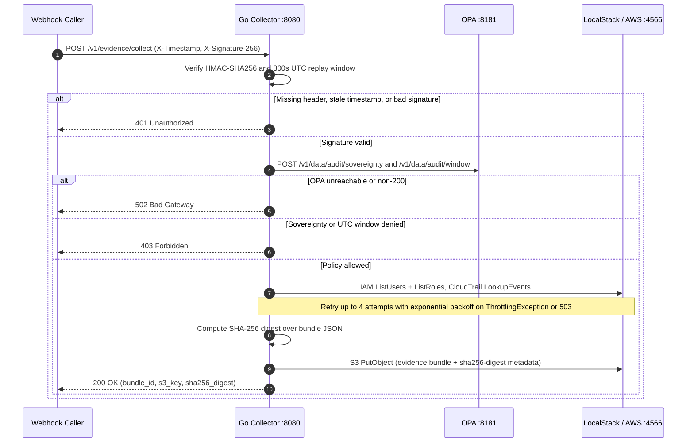
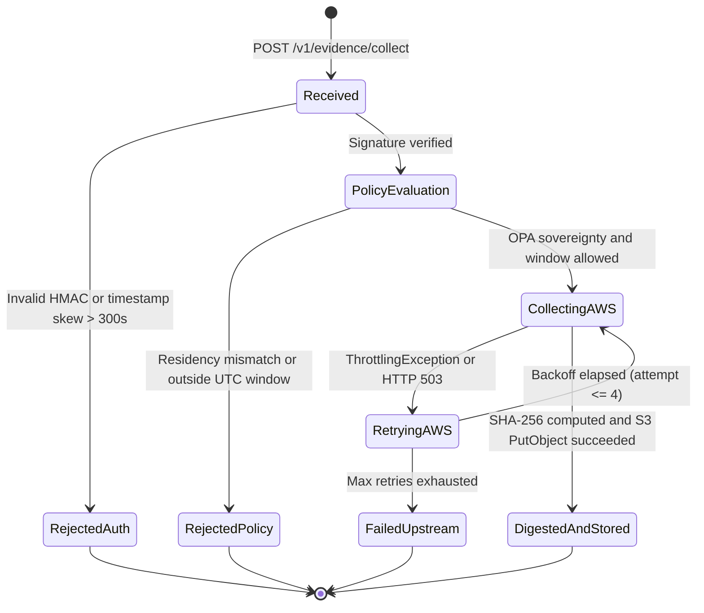

# Design Notes: AWS Audit Evidence Collector

## Overview
Compliance teams need point-in-time snapshots of AWS IAM users, IAM roles, and CloudTrail management events packaged with SHA-256 digests and stored in S3. Exposing AWS credentials directly to internal schedulers or ticketing webhooks makes it hard to enforce data residency boundaries or restrict when snapshots can run.

`aws-audit-evidence-collector` sits between internal callers and AWS APIs. It verifies HMAC-SHA256 webhook signatures, checks data residency and UTC collection windows in Open Policy Agent (OPA), queries IAM and CloudTrail using `aws-sdk-go-v2`, computes a SHA-256 digest over the collected JSON payload, and uploads the bundle to S3.

## Sequence Flow

## Evidence Bundle State Lifecycle

## Edge Cases and Trade-Offs

- Clock skew and DST transitions: `internal/webhook` and `internal/server` evaluate timestamps and operating windows (`04:00` to `23:00` UTC) exclusively in UTC so spring and autumn Daylight Saving Time shifts do not alter enforcement hours.
- Emergency audit overrides: When `emergency_audit.enabled` is true with an audit ID of at least 6 characters and a justification of at least 10 characters, OPA permits off-hours collection for `compliance-auditor` and `security-lead` roles and records `grace_extended: true` on the stored bundle.
- Upstream throttling: `internal/awsevidence` retries `ThrottlingException` and HTTP `429`/`502`/`503`/`504` responses up to 4 times with exponential backoff (`100ms` base, `2s` cap) so transient rate limits do not drop scheduled snapshots.
- Known limitations: `cloudtrail:LookupEvents` in this version fetches the latest 25 events in a single page without pagination tokens, and S3 bucket versioning/Object Lock must be enabled out-of-band on the target bucket for WORM retention.
