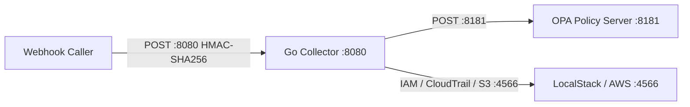

# aws-audit-evidence-collector

HTTP service in Go (`1.22`) that collects AWS IAM user/role inventories and recent CloudTrail events, computes a SHA-256 digest over the snapshot, and writes the JSON bundle to S3 after verifying HMAC-SHA256 signatures and Open Policy Agent (OPA) residency/window policies.

## System Topology



## Repository Layout

```text
aws-audit-evidence-collector/
├── cmd/collector/        # HTTP server entrypoint and health checks
├── internal/
│   ├── webhook/          # HMAC-SHA256 and UTC timestamp replay verification
│   ├── policy/           # OPA REST client for sovereignty and window checks
│   ├── awsevidence/      # aws-sdk-go-v2 IAM, CloudTrail, and S3 collector
│   └── server/           # HTTP routing and slog JSON audit logging
├── policies/             # OPA Rego rules (sovereignty.rego, collection_window.rego)
├── deploy/               # Dockerfile and docker-compose.yml (LocalStack + OPA)
├── tests/                # Unit, LocalStack/OPA integration, and benchmark tests
├── DESIGN.md             # Sequence diagram, state diagram, and trade-offs
└── Makefile              # Targets: up, down, run, test, bench, lint
```

## Prerequisites

- Go 1.22 or newer
- Docker and Docker Compose (for LocalStack and OPA)
- `curl` and `openssl` (for local request signing)

## Local Quickstart

1. Start LocalStack (`iam`, `s3`, `cloudtrail`) and Open Policy Agent:

```bash
make up
```

2. Run the collector service on `:8080`:

```bash
make run
```

3. Verify upstream container health:

```bash
curl -s http://localhost:8080/healthz
```

4. Trigger an authenticated FedRAMP evidence collection in `us-east-1`:

```bash
BODY='{"collector":"cron-worker","role":"compliance-auditor","framework":"fedramp","region":"us-east-1"}'
TS=$(date -u +%s)
SIG="sha256=$(printf '%s.%s' "$TS" "$BODY" | openssl dgst -sha256 -hmac 'local-dev-audit-secret' | awk '{print $2}')"

curl -s -X POST http://localhost:8080/v1/evidence/collect   -H "Content-Type: application/json"   -H "X-Timestamp: $TS"   -H "X-Signature-256: $SIG"   -d "$BODY"
```

## Running Tests and Benchmarks

Run unit tests and live LocalStack/OPA integration tests:

```bash
make test
```

Run HMAC verification and OPA policy evaluation latency benchmarks:

```bash
make bench
```

Stop and remove LocalStack and OPA containers:

```bash
make down
```

## Known Limitations

- Single AWS region per process: `AWS_REGION` is configured at startup; multi-region collection requires running one collector instance per region.
- CloudTrail page size: `LookupEvents` captures up to 25 recent events per bundle rather than walking full pagination tokens.
- Shared HMAC secret: callers authenticate using a single `WEBHOOK_HMAC_SECRET`; multi-tenant environments should place mTLS or per-caller key lookup in front of the service.
